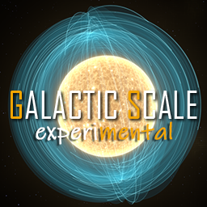

# DSP Galactic Scale 2.0 Mod

# BACKUP YOUR SAVES. SERIOUSLY.

Play with friends!
https://dsp.thunderstore.io/package/nebula/NebulaMultiplayerMod/

Remember to swing by our discord for planet themes, custom galaxies, blueprints, and help!
https://discord.gg/NbpBn6gM6d

-----------

# What Galactic Scale 2.0 is: A Framework for creating generator plugins that can completely customize everything to do with galaxy/planet generation in Dyson Sphere Program, with multiple generators built in.

What can be customized?

- Planet Sizes from 50-500 tile radius (Vanilla is 200)
- Gas Giant Sizes from 500-5000
- Star Counts from 1-1024+ stars
- Planet Themes (New planet types aplenty)
- Vein Distribution
- Terrain Generation
- Vegetation Distribution
- Star location, size, luminosity etc. All exposed to configuration.
- Binary Stars.
- System generation.
- Elliptical Orbits
- Planetary Rings for Gas Giants
- Auroras
- Comets
- All planets can have moons, including planets that are already moons. Moonception.
- Planet material customization. Tinting, texture replacement etc.
- Planet shader configuration. Change ocean and atmosphere params.
- Binary Planets.

And so much more that I've forgotten. Documentation might be coming soon! (If enough people bug me about writing it)

/!\ READ THIS

# Discord for Galactic Scale's team work

https://discord.gg/NbpBn6gM6d To talk about the mod and ask me questions directly :)

# Patch notes & releases :

See the Changelog tab for patch notes and the Versions tab for releases.

# Bug report :

Report bugs on [GitHub Issues](https://github.com/Touhma/DSP_Plugins/issues) or ping @Devious-GS2 in the Dyson Sphere Program or Galactic Scale Discord.

## Disclaimer

This mod is pretty much incompatible with anything touching on any part of the generation, though we try and work with
other mod creators to address compatibility issues.

We need feedback, bug reports, and ideas. Plus we are always looking for dev help!.

Have fun!

## How to Install :

Use r2modman, Thunderstore Mod Manager, or Gale. It's much better than manually installing.

Launch the game after installing and you should be all set !

## Generators

You can choose a generator and configure it in the in-game settings menu.

- **Galactic Scale 2** offers extensive customization of galaxy and planet generation.
- **Sol** recreates our Solar System and neighboring stars.
- **NiceSol** draws from a 1,000-star catalog covering all 88 IAU constellations and uses a configurable date to set the Solar System's orbital positions.

Additional generators are available in discord, and can be created by the community! Documentation on this feature will
be written soon.

## For modders :

We spent a lot of time working on that mod so please ... don't be a thiefy mcThieferson.

If you have some features or ideas that would need our code to work, talk to the main dev first ( innominata#0454 ) on
Discord about it. GS2 is very expandable, and you can probably do it easily with a generator or other plugin.

If you wanna fix something, please go ahead and do a pull request, we'll happily credit you for your work.

Do NOT make a mod just to change the default configuration or a few parameters, create your own generator instead :) if
it's good it can make it to the official release of the mod.

We would love that mod to be a framework for community created plugins concerning everything around the generation of
the moons, planets, stars, etc

This mod is and will always be free of charge for everyone.

Old Docs:  https://centrebra.in/

Credits:

- innominata - GS1/GS2/GS3 Code / Art
-
- Touhma - GS1 Mod Developer / Advisor
-
- Shad0wlife - GS1/GS2 Code / Advisor
-
- GlitchHound - GS1 Code / Advisor
-
- sp00ktober - GS2/GS3 Code / Advisor
-
- tyukara - GS2 Japanese Translation
-
- Mushroom - GS1 Dev Env
-
- PhantomGamers - GS2 Dev Env / Advisor
-
- starfish - GS3 Code / Advisor
-
- Kremnev8 - GS2 Code / Advisor
-
- NHunter - GS2 Code / Advisor
-
- 46Bit - GS2 Code
-
- AndrewLuebke - GS2 Code
-
- ZordDevzz - GS2 Code
-
- Xabsurd - GS2 Code / GS2 Simplified Chinese Translation
-
- Devious55 - GS2 Code / Maintainer
-
- Kimi-Arthur - GS2 Code
-
- komonad - GS2 Code
